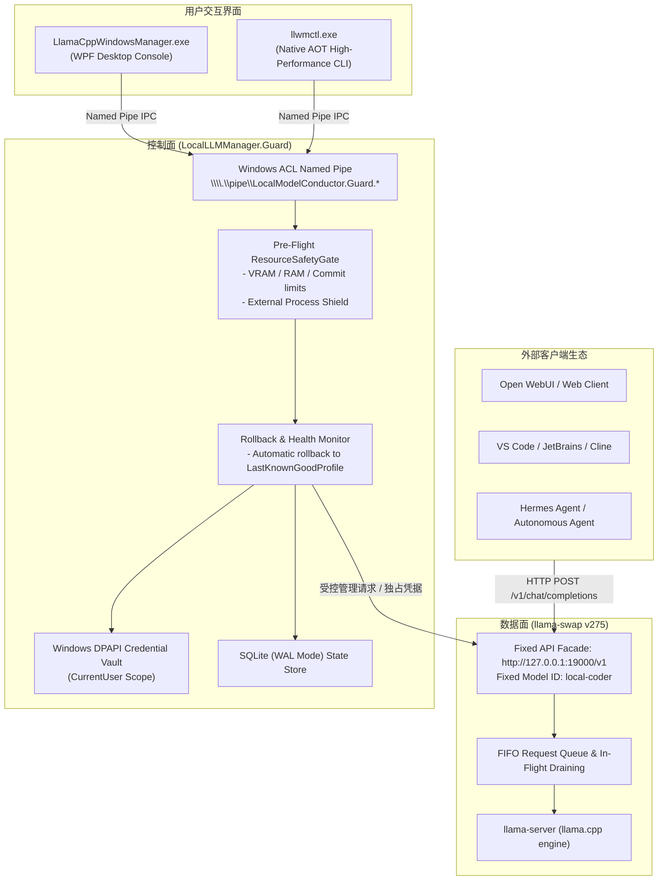

# Local Model Conductor — System Architecture

## 核心设计要点
1. **控制面与数据面彻底解耦**: UI 与 CLI 绝不直连数据面管理端口，绝不持有数据面管理密钥。所有控制指令（切换模型、回滚、暂停、恢复、重启）必须经由 Windows Named Pipe 路由至 Guard。
2. **零侵入安全隔离**: 系统自动检测主机上运行的其他 AI 模型进程（如独立部署的 Cyber-Tiel 或外部 Codex++ 驱动的模型），并将其严格分类为 `EXTERNAL_UNMANAGED` 或 `EXTERNAL_CODEX_OWNED`，禁止执行任何可能引发显存冲突的操作。
3. **高韧性状态自愈**: 当遭遇连续切换失败或显卡故障时，系统自动锁定（`FAULT_LOCKED`）并退回已知良好的稳定模型配置，保障客户端业务连续性。
